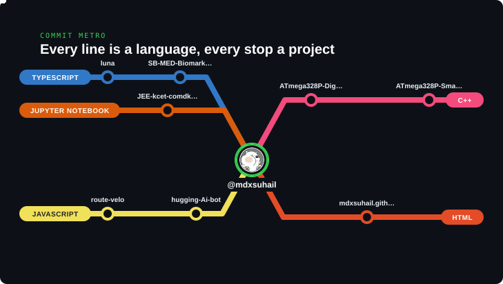

<!-- Profile README — mdxsuhail -->

<h1 align="center">Hi, I'm Suhail 👋</h1>
<h3 align="center">ECE Student | Embedded Systems • Electronics • VLSI</h3>

  Building practical projects at the intersection of electronics, firmware, and software.

---

## About

I'm an Electronics & Communication Engineering student interested in **embedded systems, digital electronics, VLSI, robotics, and applied software development**.

I'm currently strengthening my fundamentals and learning by building, testing, documenting, and improving projects. I enjoy exploring how hardware and software work together to solve real problems.

- 🔧 Focus areas: embedded systems, microcontrollers, digital design, and electronics
- 🧠 Exploring: robotics, AI-assisted applications, and hardware–software integration
- 🌱 Currently learning: C/C++, Python, circuit design, firmware, and development workflows
- 🤝 Interested in collaborating on practical engineering projects and early-stage ideas
- 📌 Approach: build small, understand the fundamentals, test, and iterate

---

## Featured Work

> Project status is described honestly; ideas and prototypes are not presented as completed products.

- **ATmega328P Digital Password Lock** — microcontroller-based access logic and input/output control.
- **Smart Parking System** — a two-slot parking prototype with sensing, display, and basic billing logic.
- **6T SRAM Cell Analysis** — transistor-level SRAM study and simulation, including VTC and SNM analysis.
- **LUNA** — an offline-first PDF reader and text-to-audio software project.
- **SB-MED / Aether** — exploratory concepts and prototype work around sensing and patient-assistance robotics; not medical devices.

Explore my repositories for source code, implementation notes, and project progress.

---

## Skills I'm Building

**Electronics & Embedded:** Arduino, ATmega328P, ESP32, sensors, digital logic, circuit prototyping

**Programming:** C, C++, Python, JavaScript

**Software & Tools:** Git, GitHub, VS Code, Arduino IDE, KiCad, LTspice

**Web & App Development:** HTML, CSS, React, Vite — learning and experimenting

---

## GitHub

  

---

## Connect

- LinkedIn: [linkedin.com/in/Mohammedsuhail03](https://linkedin.com/in/Mohammedsuhail03)
- GitHub: [@mdxsuhail](https://github.com/mdxsuhail)

---

  <i>Learning by building. Improving by testing. Growing through consistency.</i>

